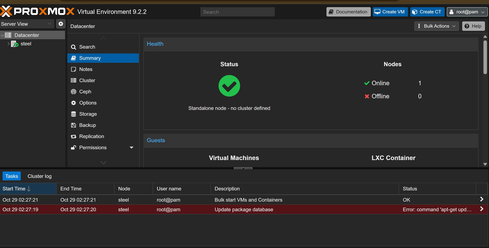

# Build log — 2026-10-26 to 2026-10-29

MemTest86, the Proxmox installer USB, and the install. Items marked ⚠️ are
unconfirmed.

## Done

- **MemTest86 passed** 2026-10-27 — both 16GB sticks, full run, 0 errors. CPU held
  38°C during the run, confirming the paste and cooler are seated.
- **Desktop stable on the 9100 Pro**, cloned from the 970. The 970 holds nothing
  unique → safe for Proxmox to wipe.
- **Server on Ethernet** — temporarily on the desktop's Cat6 (desktop on Wi-Fi).
  Permanent room and cable route TBD (ADR 0005).
- Non-ECC RAM recorded as a constraint in `docs/spec.md`, with mitigations.

## Installer USB

- **ISO verified:** `Get-FileHash` SHA256 `4e88fe41…3ef2c6c` matches Proxmox's
  official `SHA256SUMS` exactly (compared programmatically, not by eye).
- **First stick (Lexar 32GB) failed.** Rufus 4.15 reported "Write error". Its log:
  - `Windows VDS is unavailable` / `Could not delete partition(s)` — the stick's old
    partitions stayed mounted.
  - `Write error at sector 0: Incorrect function` — Windows blocks raw writes to a
    disk with a mounted volume.
  - Wiping it with `Clear-Disk` then hung Windows' storage stack (VDS stopped
    responding); a reboot recovered it, other disks Online/Healthy. Three failures
    → the stick is **retired**.
- **A new stick wrote cleanly.**
- Lesson: run disk queries on Windows inside a job with a timeout (`Start-Job` +
  `Wait-Job -Timeout`) so a stuck USB device can't freeze the session.

## Proxmox VE installed (2026-10-29)

- Booted the stick with **F11** → **Install Proxmox VE (Graphical)**.
- **Target disk: the Samsung 970 EVO Plus** (`/dev/nvme0n1`). The IronWolfs
  (`sda`/`sdb`) were not touched.
- **Filesystem: ext4** (installer default, with LVM-thin). ZFS on a single boot disk
  adds snapshots but no redundancy, and its ARC competes for RAM. The ZFS mirror on
  the data drives is built separately.
- **Timezone:** America/New_York.
- **Network:** **192.168.1.169/24**, gateway **192.168.1.1** — offered by DHCP,
  pinned in Proxmox's config. ⚠️ No DHCP reservation on the router yet.
- **Hostname:** **`steel`**.
- **Web UI: `https://192.168.1.169:8006`**, user `root`.

**Power interruption during setup.** The server was bumped; it would power on only
in certain positions, then cut out. Re-seating the connections fixed it. ⚠️ Which
connector wasn't recorded. If it recurs: PSU off, re-seat the 24-pin and the CPU
8-pin, check the board isn't flexing against the case.

**Sounds after the install reboot:** a single system beep (normal), and a brief
chirping from the IronWolfs spinning up and calibrating (normal if it settles within
about a minute).

## First web UI login

- Logged in as `root@pam` (Linux PAM). The "No valid subscription" popup is expected
  on the free version.
- Datacenter summary: healthy, standalone node, **steel** online. **VE 9.2.2**.
- Task log: **"Update package database — Error: command 'apt-get update' failed"**
  at boot. Expected — a fresh install points at the paid enterprise repository,
  which rejects unsubscribed machines. Fix: switch to the no-subscription repo.



## Next

1. Reserve **192.168.1.169** for the server on the router.
2. No-subscription repository, then update.
3. Burn in the data drives before creating the pool.
4. Vault mirror and ARC cap (Phase 1).

## Command log — desktop (admin PowerShell)

1. **List disks, look for the ISO** (read-only)
   ```powershell
   Get-Disk | Format-Table Number, FriendlyName, BusType, @{n='SizeGB';e={[math]::Round($_.Size/1GB,1)}}, PartitionStyle, OperationalStatus -AutoSize
   ```
   → Disk 0 WD 8TB (SATA), 1 9100 Pro (NVMe), 2 Seagate Backup+ (USB), 3 Lexar 29.8GB (USB).

2. **Hash the ISO** (read-only)
   ```powershell
   Get-FileHash "D:\Sftwr\proxmox-ve_9.2-1.iso" -Algorithm SHA256 | Format-List Hash
   ```
   → `4E88FE41…3EF2C6C`.

3. **Compare against the official SHA256SUMS** (read-only)
   ```powershell
   $line = Select-String -Path "<saved SHA256SUMS>" -Pattern 'proxmox-ve_9\.2-1\.iso' | Select-Object -First 1
   $official = ($line.Line -split '\s+')[0]
   $official -eq '4E88FE416DF9B527624A175F24C9AA07C714D3332AFB1EE3DBF3879573EF2C6C'
   ```
   → `True`.

4. **Wipe the Lexar — destructive, disk number confirmed manually first.** Guarded so
   it aborts if disk 3 isn't the expected device:
   ```powershell
   $d = Get-Disk -Number 3
   if ($d.FriendlyName -eq 'Lexar USB Flash Drive' -and $d.BusType -eq 'USB' -and [math]::Round($d.Size/1GB,1) -eq 29.8) {
     Clear-Disk -Number 3 -RemoveData -RemoveOEM -Confirm:$false
   } else { "ABORT: disk 3 is now '$($d.FriendlyName)' ($($d.BusType)) - not wiping" }
   ```
   → **Hung** (storage stack froze). Stick unplugged, PC rebooted.

5. **Post-reboot health check, with a 20 s timeout** (read-only)
   ```powershell
   $j = Start-Job { Get-Disk | Select-Object Number, FriendlyName, BusType, OperationalStatus, HealthStatus }
   if (Wait-Job $j -Timeout 20) { Receive-Job $j | Format-Table -AutoSize } else { "TIMEOUT"; Stop-Job $j }
   Remove-Job $j -Force
   ```
   → 9100 Pro and WD 8TB Online/Healthy.
