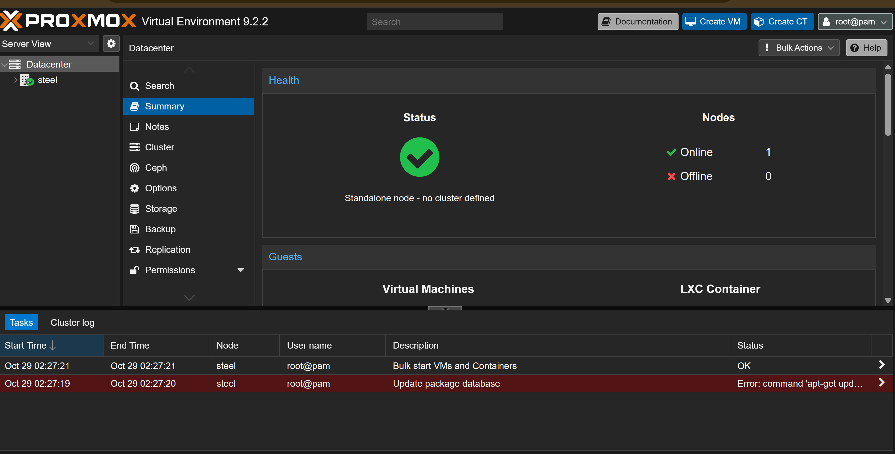

# Session log — 2026-10-26 to 2026-10-29

Continues `docs/sessions/2026-10-25.md`. Items marked ⚠️ are unconfirmed.

## Done

- **MemTest86 passed** 2026-10-27 — both 16GB sticks, full run, 0 errors. CPU sat
  at 38°C during the run, which confirms the Kryonaut and fan are seated.
- **Desktop confirmed stable on the 9100 Pro**, and it was a **clone** of the 970
  (the Python setup carried over). The 970 holds nothing unique → safe for Proxmox
  to wipe.
- **Server has Ethernet** — currently the cable borrowed from the desktop, which
  is now on Wi-Fi (temporary). Room and permanent cable route still TBD (ADR 0005).
- Proxmox VE **9.2-1** ISO downloaded on the desktop.
- Non-ECC RAM recorded as a constraint in `docs/spec.md`, with mitigations.

## Done — installer USB (resolved 2026-10-29)

- **ISO verified:** `Get-FileHash` SHA256 `4e88fe41…3ef2c6c` matches the official
  `https://enterprise.proxmox.com/iso/SHA256SUMS` exactly (compared from the raw
  file, not by eye).
- **Lexar retired.** The Seagate was unplugged and the Lexar confirmed as Disk 3
  (only USB disk). `Clear-Disk` on it **hung Windows' storage stack** (VDS stopped
  responding) and the PC needed a reboot. After the reboot the 9100 Pro and WD 8TB
  were Online/Healthy — no damage. That's three failures from the Lexar (two Rufus
  write errors, then the hung wipe), so it's treated as bad. **Don't use it for
  installers.**
- **Rufus wrote the ISO to a third, new stick successfully.**
- Lesson: run disk queries on Windows inside a job with a timeout
  (`Start-Job` + `Wait-Job -Timeout`) so a stuck USB device can't freeze the session.

## Previous attempt — writing the Proxmox installer USB (superseded)

**Stick:** Lexar USB Flash Drive, 32GB (29.8GB usable). Shows as PhysicalDrive3.

**Rufus 4.15 (Microsoft Store version) failed with "Write error". From its log:**

- `Windows VDS is unavailable` / `Could not delete partition(s)` — Rufus couldn't
  clear the stick's old partitions, so Windows kept them mounted.
- `Opened … for shared write access` → `Write error at sector 0: Incorrect function`
  — Windows blocks raw writes to a disk with a mounted volume.
- The **first attempt reached ~98%** (failed at sector 3,276,800), so the stick now
  holds a **partial Proxmox image. Do not boot or install from it.**

**Fix (next step):**

1. Unplug the **Seagate Backup+** external drive so it can't be selected.
2. In an **admin** PowerShell (VS Code run as administrator):
   ```powershell
   Get-Disk | Format-Table Number, FriendlyName, BusType, @{n='SizeGB';e={[math]::Round($_.Size/1GB,1)}}
   ```
   Find the **Lexar, BusType USB, ~29.8GB**. **A human confirms the disk number
   before anything is wiped.**
3. Wipe only that disk: `Clear-Disk -Number <N> -RemoveData -RemoveOEM`
4. Re-run Rufus. It enforces DD mode for this ISO automatically — that's correct.

**Also:** verify the ISO before writing. `Get-FileHash .\proxmox-ve_9.2-1.iso` and
compare the SHA256 against the Proxmox download page. ⚠️ Not done yet.

## Next — the install

**Setup first:** the server borrows the desktop's Cat6 and uses the OLED TV as its
monitor (same as the desktop). The desktop is on Wi-Fi meanwhile.

**Boot:**
1. Plug the new stick into a **rear** USB port (straight to the board).
2. Power on, tap **F11** → MSI boot menu → pick the **"UEFI:"** entry for the stick.
3. Blue Proxmox menu → **Install Proxmox VE (Graphical)**.

**Installer screens — one at a time, confirm each before clicking Next:**
- **Target harddisk:** see the bullets below. This is the screen that matters.
- **Filesystem (Options button):** ⚠️ **not decided.** Default is ext4 + LVM-thin.
  ZFS on a single disk adds snapshots but no redundancy, and its ARC eats RAM we're
  already capping. Leaning ext4 (default) — confirm with the owner before choosing.
- **Country/timezone/keyboard:** owner's choice.
- **Password + email:** owner sets; store the root password somewhere safe.
- **Hostname / IP:** ⚠️ **TBD.** Installer offers a DHCP address — write it down.
  Better long term: a DHCP reservation on the router so the IP never changes.
- **Summary screen:** re-check the target disk reads `nvme0n1` / 970 EVO Plus before
  clicking Install.

After install: the web UI is at `https://<server-ip>:8006` from the desktop (accept
the self-signed cert warning). Login `root` + the password set above.

**Target-disk rules:**
- **Target harddisk = the 970**: `/dev/nvme0n1`, "Samsung SSD 970 EVO Plus", ~931GB.
- **Not** `/dev/sda` or `/dev/sdb` — those are the IronWolfs (~3.6TB each). They stay
  untouched until burn-in and ZFS pool creation.
- After install: **burn in the IronWolfs before creating the pool**, inside the
  retailer's return window (bought 2026-10-21; ⚠️ window length unknown).

## Working notes

- Shells: **PowerShell on Windows, bash on the server** (Proxmox is Debian). cmd
  isn't needed.
- The remote-device connection used by Claude in the desktop app **can't reach
  github.com**. Push from Windows (Claude Code or a terminal).

## Command log — 2026-10-29 (Claude Code, desktop)

Every PowerShell command run this session, in order, with the outcome. All ran in
an **admin** PowerShell on the desktop (Node A).

1. **List disks + look for the ISO in Downloads** (read-only)
   ```powershell
   Get-Disk | Format-Table Number, FriendlyName, BusType, @{n='SizeGB';e={[math]::Round($_.Size/1GB,1)}}, PartitionStyle, OperationalStatus -AutoSize
   Get-ChildItem -Path "$env:USERPROFILE\Downloads" -Filter "proxmox*.iso" -Recurse -ErrorAction SilentlyContinue | Select-Object FullName, Length
   ```
   → Disk 0 WD 8TB (SATA), 1 9100 Pro (NVMe), 2 Seagate Backup+ (USB), 3 Lexar 29.8GB (USB). ISO not found.

2. **Check admin rights + wider ISO search** (read-only)
   ```powershell
   ([Security.Principal.WindowsPrincipal][Security.Principal.WindowsIdentity]::GetCurrent()).IsInRole([Security.Principal.WindowsBuiltInRole]::Administrator)
   Get-ChildItem -Path "$env:USERPROFILE" -Filter "proxmox*.iso" -Recurse -Depth 3 -ErrorAction SilentlyContinue | Select-Object FullName, Length
   ```
   → `True` (admin). ISO not found — owner supplied `D:\Sftwr\proxmox-ve_9.2-1.iso`.

3. **Re-list disks (Seagate unplugged) + hash the ISO** (read-only)
   ```powershell
   Get-Disk | Format-Table Number, FriendlyName, BusType, @{n='SizeGB';e={[math]::Round($_.Size/1GB,1)}}, PartitionStyle -AutoSize
   Get-FileHash "D:\Sftwr\proxmox-ve_9.2-1.iso" -Algorithm SHA256 | Format-List Hash
   ```
   → Lexar still Disk 3, only USB disk. Hash `4E88FE41…3EF2C6C`.

4. **Compare against the official SHA256SUMS** (read-only; file fetched from
   `https://enterprise.proxmox.com/iso/SHA256SUMS`)
   ```powershell
   $line = Select-String -Path "<saved SHA256SUMS>" -Pattern 'proxmox-ve_9\.2-1\.iso' | Select-Object -First 1
   $official = ($line.Line -split '\s+')[0]; $official
   $official -eq '4E88FE416DF9B527624A175F24C9AA07C714D3332AFB1EE3DBF3879573EF2C6C'
   ```
   → `True`. ISO verified.

5. **Wipe the Lexar — DESTRUCTIVE, owner confirmed "wipe 3"**
   ```powershell
   $d = Get-Disk -Number 3
   if ($d.FriendlyName -eq 'Lexar USB Flash Drive' -and $d.BusType -eq 'USB' -and [math]::Round($d.Size/1GB,1) -eq 29.8) {
     Clear-Disk -Number 3 -RemoveData -RemoveOEM -Confirm:$false
     Get-Disk -Number 3 | Format-Table Number, FriendlyName, BusType, PartitionStyle, @{n='SizeGB';e={[math]::Round($_.Size/1GB,1)}} -AutoSize
     Get-Partition -DiskNumber 3 -ErrorAction SilentlyContinue
   } else { "ABORT: disk 3 is now '$($d.FriendlyName)' ($($d.BusType)) - not wiping" }
   ```
   → **Hung.** Windows' storage stack froze; owner unplugged the stick and rebooted.
   Whether the wipe finished is unknown. Lexar retired.

6. **Post-reboot health check, with a 20 s timeout** (read-only)
   ```powershell
   $j = Start-Job { Get-Disk | Select-Object Number, FriendlyName, BusType, PartitionStyle, OperationalStatus, HealthStatus, @{n='SizeGB';e={[math]::Round($_.Size/1GB,1)}} }
   if (Wait-Job $j -Timeout 20) { Receive-Job $j | Format-Table -AutoSize } else { "TIMEOUT: storage service still not responding"; Stop-Job $j }
   Remove-Job $j -Force
   Get-Service vds, smphost | Format-Table Name, Status -AutoSize
   ```
   → 9100 Pro and WD 8TB Online/Healthy. Lexar absent (unplugged). `vds` Stopped, `smphost` Running.

Bash (Git Bash) was used only to read repo files and to commit/push — no system changes.

## Done — Proxmox VE installed (2026-10-29, late night, over voice)

- Booted the new stick with **F11** → **Install Proxmox VE (Graphical)**. Driven by
  keyboard only (no mouse attached).
- **Target harddisk: the Samsung 970 EVO Plus** (NVMe). The IronWolfs were not
  touched.
- **Filesystem: ext4** (installer default, with LVM-thin). Resolves the ⚠️ above.
  The ZFS mirror on the IronWolfs gets built separately later.
- **Timezone:** America/New_York. Root password and alert email set by the owner
  (not recorded here).
- **Network:** IP **192.168.1.169/24**, gateway **192.168.1.1** — offered by DHCP,
  now fixed in Proxmox's config. The cable was missing on the first boot attempt;
  the install was restarted with it plugged in.
- **Hostname:** **`steel`** — confirmed from the web UI's browser tab title.
  Domain part not recorded.
- Install finished, rebooted from the 970, and the console shows the login prompt
  plus the web UI address. **Web UI: `https://192.168.1.169:8006`**, user `root`.
  ⚠️ Browser login from the desktop not yet confirmed.
- The 970's old Windows copy is gone — expected (ADR 0006).

**Incident — server knocked mid-session.** All lights went out; it would only power
on with the case in a certain position, then cut out shortly after. Reseating fixed
it ("loose connection solved"). ⚠️ Which connector wasn't recorded. If it recurs:
rocker off, re-seat the 24-pin and the CPU 8-pin, and check the board isn't flexing
against the case. A PSU cutting out on a short is its protection working.

**Noises after the install reboot:**
- A single beep at reboot — the system beep. Normal.
- A "dial-up"-like chirping — most likely the IronWolfs spinning up and calibrating.
  Normal if it settles within about a minute. Persistent seeking at idle, rhythmic
  clicking, or grinding → check SMART before trusting them.

No shell commands were run on the server or the desktop for this step — it was
all installer screens. Repo edits were made by Claude in the desktop app.

## Next

1. **Log in to the web UI** from the desktop: `https://192.168.1.169:8006`, accept
   the self-signed certificate warning, user `root`.
2. **Reserve 192.168.1.169** for the server in the router (DHCP reservation), so the
   router never hands that address to another device.
3. Post-install basics: switch to the no-subscription repository, then update.
4. **Burn in the IronWolfs** before creating the pool, inside the return window:
   SMART long tests, then a full-surface write/read pass. SMART check on the 970 too.
5. Then the Vault mirror and the ARC cap (Phase 1).

## End of night

- **Web UI reached** from the desktop at `https://192.168.1.169:8006` — the login
  page loads, so network, install and certificate path all work. Login itself
  not yet done.
- Server left **running overnight**. GPU idles without a driver — harmless.

## 2026-10-29 evening — first web UI login

- Logged in as `root@pam` (realm: Linux PAM) at `https://192.168.1.169:8006`.
  Dismissed the "No valid subscription" popup — expected on the free version.
- Datacenter summary: status healthy, standalone node, **steel** online.
  Proxmox reports **VE 9.2.2**.
- Task log shows **"Update package database — Error: command 'apt-get update'
  failed"** at boot (02:27). Expected: the install points at the paid enterprise
  repository, which rejects machines without a subscription. Fix = switch to the
  no-subscription repo (next step).


